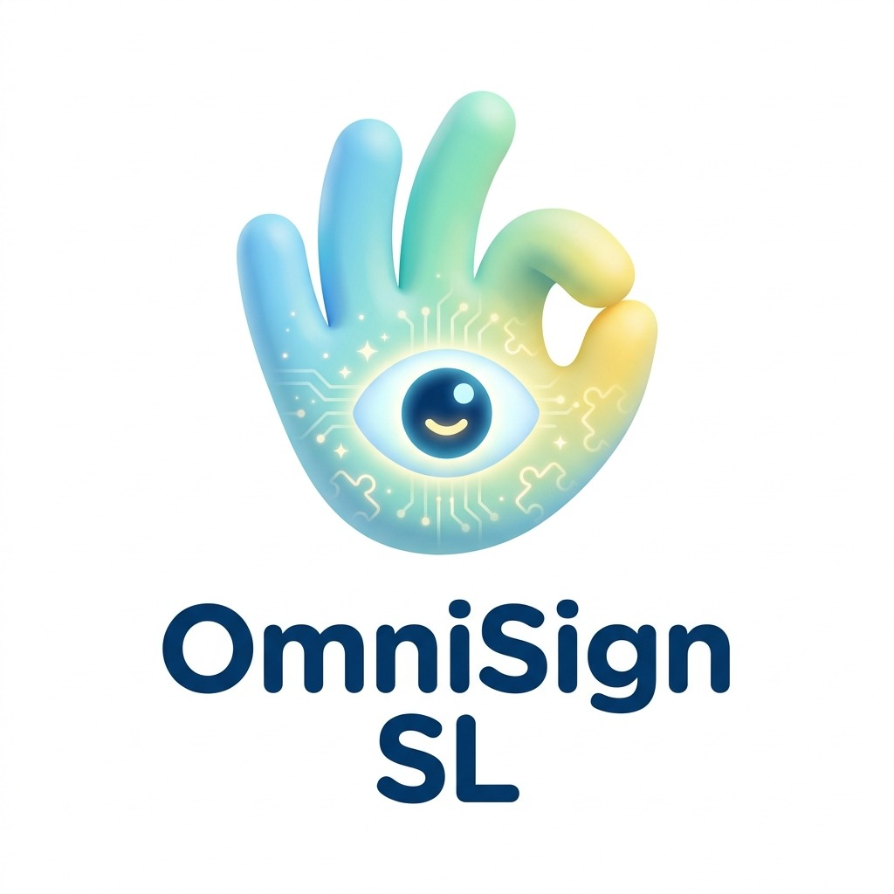
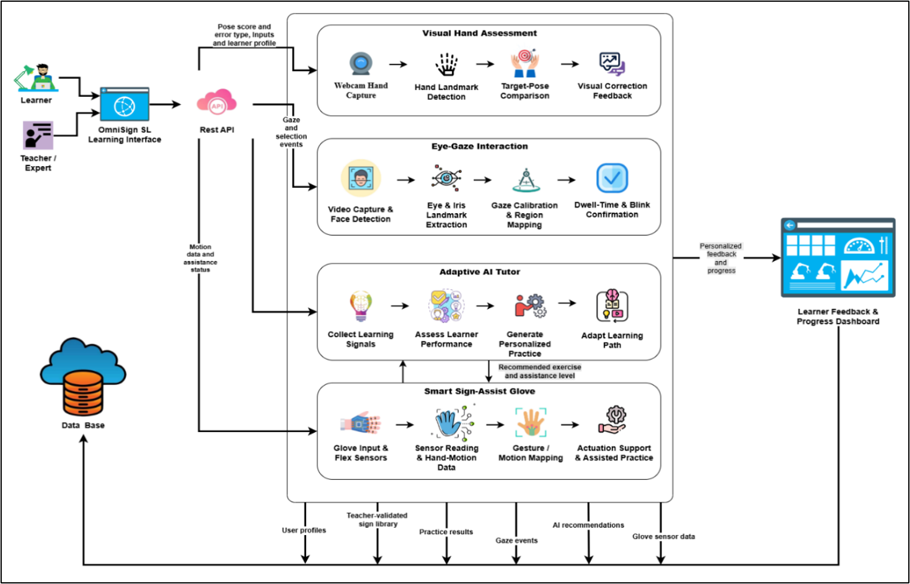

<p align="center">
  
</p>

<h1 align="center">OmniSign SL</h1>

<p align="center">
  Sign Language Learning for Primary School Students<br>
  Using Gaze Detection and Smart Gloves
</p>

<p align="center">
  Visual Feedback · Guided Practice · Adaptive Learning · Accessible Interaction
</p>

<p align="center">
  <a href="#-overview">Overview</a> ·
  <a href="#-research-components">Components</a> ·
  <a href="#-system-architecture">Architecture</a> ·
  <a href="#-quick-start">Quick Start</a> ·
  <a href="#-research-team">Team</a>
</p>

---

## 🌐 Overview

OmniSign SL is a research prototype designed to support Sri Lankan
Sign Language learning for deaf and hard-of-hearing primary-school learners.

The project brings together visual hand assessment, optional smart-glove
guidance, adaptive tutoring and gaze-based interaction within a shared
learning-platform design.

- Support guided sign-language practice.
- Provide understandable feedback and learning assistance.
- Offer alternative ways to interact with learning activities.
- Support learners, teachers and caregivers.

| Project | Details |
|---|---|
| Name | OmniSign SL |
| Project ID | J26-IT-327 |
| Institution | SLIIT – Faculty of Computing |
| Status | Research prototype — under development |

> Component descriptions explain the project scope. Feature availability
> depends on the current implementation; complete integration of all four
> components is not claimed.

## 🧩 Research Components

| Component | Purpose | Main Functions |
|---|---|---|
| **C01 — Visual Hand Assessment** | Support sign practice through webcam-based assessment and visual feedback. | Hand-landmark processing, reference-based assessment, sign classification and Sinhala feedback. |
| **C02 — Smart-Glove Assistance** | Investigate optional physical support for guided sign formation. | Finger-bend sensing, calibration, target-pose comparison and controlled guidance. |
| **C03 — Adaptive AI Tutor** | Support personalized practice and learner-progress understanding. | Learning-event assessment, activity recommendations and progress analytics. |
| **C04 — Gaze Interaction** | Support accessible, hands-free interaction with learning activities. | Gaze calibration, region mapping, dwell selection and blink confirmation. |

C01 API functionality is documented in the setup below.
The listed C02–C04 functions describe their intended scope; current
implementation and standalone setup details require component-owner confirmation.

## 🏗️ System Architecture

<p align="center">
  
</p>

The shared learning interface connects the four research areas with
reference content and learner-progress services.

- Visual assessment provides on-screen practice feedback.
- The smart glove is intended to provide optional physical guidance.
- The tutor is intended to use learning information for recommendations.
- Gaze interaction is intended to support accessible navigation.

The diagram represents the overall design. Individual connections may
still be under development.

## 🛠️ Technology Stack

| Area | Technologies |
|---|---|
| Web Interface | React, TypeScript, Vite |
| Browser Vision | MediaPipe Tasks Vision |
| 3D Interface Support | Three.js, React Three Fiber, Drei |
| Platform Data Client | Supabase JavaScript Client |
| Python API | FastAPI, Uvicorn, Pydantic |
| Vision and Data Processing | OpenCV, MediaPipe, NumPy, pandas |
| Machine Learning | scikit-learn, joblib |
| Evaluation Tools | matplotlib, seaborn |
| Proposed Glove Hardware | ESP32, flex sensors, PCA9685, MG90S servos and tendon mechanisms |

The technology list includes current software dependencies and the
documented glove design. It does not imply that every related feature
is fully integrated.

## 📁 Key Repository Locations

| Location | Purpose |
|---|---|
| `frontend/` | Web application |
| `ml/requirements.txt` | Python dependency list |
| `ml/api/main.py` | Documented C01 API entry point |
| `ml/src/` | Python processing services |
| `ml/models/` | Model artifacts |
| `docs/images/` | Documentation images |

## 🚀 Quick Start

### Requirements

- Node.js and npm.
- Python and pip.
- A webcam for camera-based activities.
- Supabase project configuration for Supabase-dependent features.
- Required model and reference-template files.

Reported development-machine versions:

| Tool | Version |
|---|---|
| Node.js | 22.14.0 |
| npm | 10.9.2 |
| Python | 3.13.3 |

These versions describe the development environment, not a verified
cross-platform compatibility matrix.

### 1. Get the Project

```bash
git clone [https://github.com/Tharani72/J26-IT-327.git](https://github.com/Tharani72/J26-IT-327.git)
cd J26-IT-327
```

Repository access is required.

### 2. Install Web Dependencies

From the repository root:

```bash
cd frontend
npm install
cd ..
```

### 3. Prepare the Python Environment

From the repository root:

```bash
python -m venv .venv
```

Activate the environment using the command for your terminal:

| Terminal | Command |
|---|---|
| Windows Command Prompt | `.venv\Scripts\activate.bat` |
| Windows PowerShell | `.\.venv\Scripts\Activate.ps1` |
| macOS / Linux | `source .venv/bin/activate` |

Install dependencies:

```bash
python -m pip install -r ml/requirements.txt
```

The dependency file must include the packages used by the API and its
imported services. The supplied API requires FastAPI, Uvicorn and
Pydantic with `model_dump()` support.

### 4. Configure the Web Application

Create `frontend/.env.local`:

```dotenv
VITE_SUPABASE_URL=YOUR_SUPABASE_PROJECT_URL
VITE_SUPABASE_PUBLISHABLE_KEY=YOUR_SUPABASE_PUBLISHABLE_KEY
```

- Replace the placeholders with the appropriate project values.
- Do not use privileged secret or service-role keys in frontend configuration.
- Keep local environment files out of version control.
- Restart the frontend after configuration changes.

Supabase-dependent features also require the corresponding database,
authentication and access-policy configuration.

### 5. Check Required Assets

The documented API expects:

```text
ml/models/sign_model.pkl
ml/models/label_encoder.pkl
```

The reference-feedback service and its required template assets must
also be available. Obtain model files from a trusted project source.

### 6. Start the Application

Keep the following services running in separate terminals.

| Terminal | Working Directory | Command |
|---|---|---|
| Backend | Repository root, with Python environment activated | `python -m uvicorn ml.api.main:app --reload` |
| Frontend | `frontend/` | `npm run dev -- --port 5173 --strictPort` |

Open the frontend address printed in the terminal.

The backend currently permits browser requests from:

```text
http://localhost:5173
http://127.0.0.1:5173
```

If the frontend origin changes, update the backend CORS configuration.

> These commands start the shared web application and the documented C01
> API. Additional glove, tutor or gaze services, if required by their current
> implementations, are not yet covered by this startup guide.

## ▶️ Using the Application

For the available webcam sign-practice flow:

1. Start the backend and frontend.
2. Open the application.
3. Navigate to sign practice and select an available item.
4. Grant webcam permission.
5. Position the hand within the camera view.
6. Follow the reference media and available feedback.

Other learning and accessibility activities depend on the components
integrated into the current application version.

### Backend Health Check

With the default local backend address, open:

```text
http://127.0.0.1:8000/health
```

A successful response includes `ok: true` and the available
reference-template keys.

## 📦 Build and Preview

From `frontend/`:

```bash
npm run build
```

After a successful build:

```bash
npm run preview
```

- The build runs TypeScript checking before Vite bundling.
- The preview server may use a different origin.
- Backend CORS must permit that origin if API access is needed.
- Development startup commands are not production deployment instructions.

## 🔎 Troubleshooting

| Issue | What to Check |
|---|---|
| Dependency installation fails | Runtime versions, dependency declarations and installation errors |
| Python package cannot be imported | Activated environment and `ml/requirements.txt` |
| `ml` cannot be imported | Start the backend from the repository root |
| Model file is missing | Required artifacts under `ml/models/` |
| Reference service fails | Service imports and template assets |
| Frontend cannot reach backend | Backend status, frontend API configuration and CORS |
| Port 5173 is occupied | Stop the conflicting process or update ports consistently |
| Supabase functionality fails | Environment values, service access and database/authentication policies |
| Webcam does not open | Browser permission, camera connection and other applications using it |
| Frontend build fails | TypeScript and dependency errors reported in the terminal |

## 📝 Current Notes and Roadmap

- This is an evolving research prototype.
- Recognition coverage depends on the installed models and reference content.
- Word-sequence SVM training scripts are available, but the supplied C01
  API does not load those word models.
- Model-classification results should not be described as overall system
  accuracy or educational effectiveness.
- Complete multi-component integration and setup documentation remain
  development tasks.
- Session-specific prediction handling, access controls and broader
  evaluation require further work.

Detailed training code, API specifications and evaluation reports belong
in supporting documentation rather than this quick-start guide.

## 🔐 Privacy and Safety

- Do not commit credentials, private learner data or confidential records.
- Use datasets, expert videos and reference materials with appropriate permission.
- Verify actual data handling before making retention or privacy guarantees.
- Follow the required approvals and consent procedures for participant research.
- Validate glove safeguards and supervised-use conditions before participant use.

The prototype is not presented as a certified medical or assistive device.

## 👥 Research Team

| Name | Student ID |
|---|---|
| Bandara W.G.T.H. | IT23318748 |
| Senevirathne H.M.S.A.B. | IT23149762 |
| Bandara M.G.K.D. | IT23278226 |
| Abayarathne H.M.L.P. | IT23296732 |

### Supervision

| Role | Name |
|---|---|
| Supervisor | Ms. Jenny Krishara |
| Co-supervisor | Ms. Poorna Panduwapala |
| External Supervisor | Mr. Samantha Gunathilake |
| External Supervisor | Mr. Nimal Hettiarachchi |

## 📄 Usage Terms

Refer to any repository license and applicable institutional policies
before reusing or redistributing project materials.

This README does not grant an open-source license.
Third-party libraries, datasets, expert videos and visual assets remain
subject to their respective permissions and usage terms.
